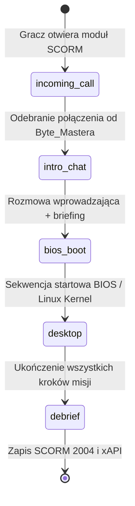

# Dokumentacja Techniczna Silnika SCORM (HACKERS.OS)

Kompleksowy przewodnik architektoniczny i podręcznik twórcy scenariuszy cyberbezpieczeństwa dla Moodle (`mod_scorm`).

---

## 🚨 1. ZASADY NACZELNE ARCHITEKTURY

1. **Scenariusz = Samodzielna Paczka SCORM 2004 4th Edition (.zip)**:
   - Każda misja (np. Misja 3 – O&L Company, Misja 4 – Energy Rock) kompiluje się do osobnego pliku ZIP.
   - W interfejsie graficznym gracza **NIE MA I NIE MOŻE BYĆ** żadnego przełącznika ani selektora scenariuszy. Student w LMS Moodle rozwiązuje jeden, przypisany do modułu scenariusz.
2. **Ścisły podział Silnik vs Scenariusze**:
   - `src/engine/`: Współdzielona platforma techniczna (Dual-Screen UI, maszyna stanów, SCORM/xAPI, audio, baza 11 widgetów).
   - `src/scenarios/`: Wyłącznie deklaratywne dane misji (`data/missionX.json`), dokumentacja (`docs/`) i plik rejestrujący (`index.ts`).
3. **Czysto deklaratywny przepływ (Zero Code dla nowych misji)**:
   - Nowe scenariusze korzystające ze znanych widgetów definiują fabułę, odblokowania i dialogi w obiekcie `transitions` w pliku JSON bez dotykania kodu TypeScript w silniku.

---

## 2. ARCHITEKTURA PROJEKTU

```
RedBlueTeam/
├── src/
│   ├── engine/                     # RDZEŃ SILNIKA (Współdzielony)
│   │   ├── apps/                   # Uniwersalne aplikacje systemowe (ChatApp, DebriefApp)
│   │   ├── audio/                  # Synteza Web Audio API (soundEffects.ts)
│   │   ├── components/             # Powłoka graficzna (Desktop, Dual-Screen, BootSequence, Window)
│   │   ├── registry/               # Rejestr misji i kafelków pulpitu (missionRegistry, appRegistry)
│   │   ├── scorm/                  # Standard SCORM 2004 4th Edition + xAPI (scorm2004, xapi)
│   │   ├── store/                  # Stan globalny Zustand (useMissionStore.ts)
│   │   ├── types/                  # Typy TypeScript (mission.ts)
│   │   └── widgets/                # KATALOG REUŻYWALNYCH MINIGIER / APLIKACJI (11 widgetów)
│   │       ├── VirusDatabaseApp.tsx
│   │       ├── RansomwareVirusApp.tsx
│   │       ├── RansomwareBuilderApp.tsx
│   │       ├── TorBrowserApp.tsx
│   │       ├── PendriveApp.tsx
│   │       ├── DroneApp.tsx
│   │       ├── RatSessionApp.tsx
│   │       ├── PhishingMailApp.tsx
│   │       ├── VpnApp.tsx
│   │       ├── WorkstationExfiltrationApp.tsx
│   │       ├── NegotiationChatApp.tsx
│   │       └── index.ts
│   └── scenarios/                  # SCENARIUSZE (Tylko dane)
│       ├── mission_03_ol_company/
│       │   ├── data/mission3.json  # Deklaratywna specyfikacja Misji 3
│       │   └── index.ts            # Rejestracja i re-eksport definicji
│       └── mission_04_energy_rock/
│           ├── data/mission4.json  # Deklaratywna specyfikacja Misji 4
│           ├── docs/               # Materiały źródłowe / PDF
│           └── index.ts            # Rejestracja i re-eksport definicji
├── scripts/
│   └── package-scorm.js            # Generator paczek SCORM 2004 ZIP
└── tests/                          # Testy jednostkowe i integracyjne (Vitest)
```

---

## 3. WORKFLOW ROZGRYWKI I PACING

Silnik realizuje strukturę **Dual-Screen Terminal**:
- **Lewy monitor (60% szerokości)**: Pulpit HACKERS.OS, okna minigier, pasek zadań, przełącznik dźwięku, zegar systemowy oraz przycisk pomocy `WSKAZÓWKA [?]`.
- **Prawy monitor (40% szerokości)**: Bezpieczny komunikator TOR P2P ze wspólnikiem `BYTE_MASTER`.

### Fazy Maszyny Stanów (`bootStage`):


1. **`incoming_call`**: Dźwięk dzwonka, pulsujący przycisk akceptacji połączenia.
2. **`intro_chat`**: Dialog wprowadzający z Byte_Masterem, zarysowanie celu operacji.
3. **`bios_boot`**: Realistyczny terminal uruchomieniowy (sekwencja bootowania jądra systemu hakera).
4. **`desktop`**: Pulpit operacyjny:
   - **Bramkowanie ikon (`unlockedOnly`)**: Gracz widzi tylko aplikacje odblokowane w danym momencie misji.
   - **Powiadomienia (`notificationBadges`)**: Pulsujące odznaki `[1]` wskazujące kolejny krok.
   - **Wskazówki (`WSKAZÓWKA [?]`)**: Pasek w górnej belce podpowiadający graczowi kolejny ruch (np. *"Sprawdź prawy monitor i odpowiedz Byte_Masterowi"*).
5. **`debrief`**: Interaktywne podsumowanie operacji, przegląd wszystkich wyborów, analiza błędów i baza wiedzy edukacyjnej.

---

## 4. SYSTEM 3-STOPNIOWEJ OCENY I KONSEKWENCJI

Każda decyzja gracza w minigrach lub na czacie jest ewaluowana w jednym z 3 poziomów:

| Poziom | Wizualizacja | Wpływ na punkty / BTC | Przebieg fabularny |
| :--- | :--- | :--- | :--- |
| **`ideal`** | 🟢 Zielony (Sukces) | 100% punktów, pełna nagroda BTC | Płynny postęp operacji. |
| **`suboptimal`** | 🟡 Żółty (Nieoptymalny) | Potrącenie punktów (np. -10 pkt) oraz ułamka BTC (np. -0.45 do -0.89 BTC) | **Gra toczy się dalej**. Gracz popełnił błąd niemający natychmiastowych skutków alarmowych (np. słabsze hasło, literówka w nazwie, wysłanie z prywatnego maila bez powiązania). Możliwość przeanalizowania błędu w Debriefie. |
| **`critical`** | 🔴 Czerwony (Wykrycie) | Duża kara punktowa, naliczenie `criticalErrorsCount + 1` | **NATYCHMIASTOWE PRZERWANIE GRY**. Syrena alarmowa, czerwony ekran **`ZOSTAŁEŚ WYKRYTY!`** ze szczegółami wpadki oraz modal **`POWTÓRKA`**. |

### Modal Powtórki (`RetryModal`):
Gdy gracz zostanie wykryty, może wybrać jeden z 2 trybów:
- **OD POCZĄTKU (`retryFromScratch`)**: Pełny restart misji wraz z połączeniem wstępnym i bootowaniem BIOS.
- **OD WYBORÓW (`retryFromChoices`)**: Natychmiastowy skok na pulpit z otwartą pierwszą aplikacją bez konieczności przeklikiwania dialogów wstępnych.

---

## 5. KATALOG 11 WIDGETÓW SILNIKA (`src/engine/widgets/`)

Wszystkie minigry są generycznymi komponentami silnika zarejestrowanymi w `appComponentRegistry` pod stałymi identyfikatorami `componentId`:

| `componentId` | Nazwa Widgetu | Rola w symulacji | Wymagane dane w JSON misji |
| :--- | :--- | :--- | :--- |
| `virus_database` | `VirusDatabaseApp` | Wybór rodzaju szkodnika + 3-parametrowy builder ładunku RAT (moduł, maskowanie, paczka). | `step1.viruses`, `step1.ratBuilder` |
| `ransomware_virus_scanner` | `RansomwareVirusApp` | Selekcja wirusa pod kątem szantażu + interaktywny skaner matrycy HEX. | `step1.viruses` (flaga `badgeColor`, `isCorrect`) |
| `ransomware_builder` | `RansomwareBuilderApp` | Generator klucza RSA/AES o zmiennej entropii + strategia okupu + kreator wyglądu okna szantażu. | `step1.keyGenerator`, `step1.ransomOptions`, `step1.designThemes` |
| `browser` | `TorBrowserApp` | Przeglądarka OSINT: profile pracowników (bio, role, słabe punkty) oraz tablica ogłoszeń firmowych. | `step2.browser`, `step2.employees`, `step2.news` |
| `pendrive_app` | `PendriveApp` | Konfigurator nośnika USB: wybór przynęty, wstrzyknięcie payloadu, etykieta woluminu i podpis na kopercie. | `step3.attachments`, `step3.volumeOptions`, `step3.envelopeOptions` |
| `drone_app` | `DroneApp` | Dron Condor: podgląd telemetrii, mapa taktyczna 4 współrzędnych i kamera celownicza zrzutu na parking. | `step4.droneStats`, `step4.mapLocations`, `step4.parkingCars` |
| `rat_session` | `RatSessionApp` | Zdalna sesja przejętego pulpitu Windows ofiary + interaktywny graf sieci zakładowej. | `step5.host`, `step5.desktopIcons` |
| `mail` | `PhishingMailApp` | Klient pocztowy: konstruowanie spear-phishingu (odbiorca, temat, treść socjotechniczna, załącznik). | `step2.emailTargets`, `step2.mailTemplates` |
| `vpn_app` | `VpnApp` | Konfigurator tożsamości sieciowej: dobór oktetów IP, maski podsieci i adresu nadawcy maila. | `step3.vpnNodes`, `step3.identities` |
| `victim_workstation` | `WorkstationExfiltrationApp` | Panel ofiary: uruchomienie procedury szyfrowania ransomware + selekcja plików do kradzieży (uwaga na honeypoty). | `step4.files`, `step4.encryptionProgress` |
| `negotiation` | `NegotiationChatApp` | Komunikator negocjacyjny z ofiarą: ustalanie terminu, żądanie BTC, reagowanie na groźby zawiadomienia policji. | `step5.negotiationSteps`, `step5.victimReplies` |
| `debrief_app` | `DebriefApp` | Raport końcowy: statystyki, bilans BTC, omówienie 3 poziomów każdego wyboru, slajdy edukacyjne i wysyłka SCORM/xAPI. | `step6.summary`, `step6.choices`, `step6.educationalSlides` |

---

## 6. JAK DODAĆ NOWY SCENARIUSZ (DEKLARATYWNIE PRZEZ `transitions`)

Nowy scenariusz tworzy się w 100% deklaratywnie w JSON:

### Krok 1: Utwórz katalog misji
Stwórz folder `src/scenarios/mission_05_nowa_misja/`:
- `data/mission5.json`
- `index.ts`

### Krok 2: Zdefiniuj przejścia w `data/mission5.json`
W pliku JSON możesz zdefiniować kafelki pulpitu oraz obiekt `transitions`:
```json
{
  "mission": {
    "id": "mission-5-nowa-misja",
    "title": "MISJA 5 – NOWA OPERACJA",
    "targetCompany": "TechCorp",
    "rewardBtc": 5.0,
    "maxScore": 100
  },
  "desktopApps": [
    {
      "id": "virus_scanner",
      "label": "//SKANER WIRUSÓW",
      "color": "#ec4899",
      "icon": "Bug",
      "componentId": "ransomware_virus_scanner"
    },
    {
      "id": "mail",
      "label": "//MAIL",
      "color": "#38bdf8",
      "icon": "Mail",
      "componentId": "mail",
      "unlockedOnly": true
    }
  ],
  "transitions": {
    "virus_done": {
      "id": "virus_done",
      "closeActiveApp": true,
      "unlockIcons": ["mail"],
      "badges": { "mail": 1, "chat": 1 },
      "timeJump": "09:30",
      "byteMasterMessages": [
        { "text": "Ładunek gotowy! Teraz przygotuj maila do rekrutacji." }
      ],
      "nextChatChoices": [
        {
          "id": "open_mail_choice",
          "label": "OTWIERAM POCZTĘ",
          "openAppId": "mail"
        }
      ]
    }
  }
}
```

### Krok 3: Wywołanie przejścia
Wystarczy, że minigra wywoła `runScenarioTransition("virus_done")` lub gracz kliknie opcję na czacie powiązaną z `nextTransitionId`. Silnik automatycznie:
- Zamknie bieżące okno (`closeActiveApp`).
- Odblokuje nowe ikony na pulpicie (`unlockIcons`).
- Ustawi powiadomienia `[1]` (`badges`).
- Wykona przeskok czasu w grze (`timeJump`).
- Wyświetli wiadomość od Byte_Mastera z animacją pisania i ustawi kolejne opcje odpowiedzi.

### Krok 4: Zarejestruj w `missionRegistry.ts` i `scripts/package-scorm.js`
Dodaj wpis w `src/engine/registry/missionRegistry.ts` oraz w skrypcie pakującym.

---

## 7. JAK DODAĆ NOWĄ MINIGRĘ (WIDGET) DO SILNIKA

Jeśli scenariusz wymaga zupełnie nowej mechaniki (np. łamanie Wi-Fi w terminalu):
1. Utwórz komponent w `src/engine/widgets/WifiCrackerApp.tsx`.
2. Do komunikacji ze stanem używaj `useMissionStore`:
   - `recordChoice(choice, penalty)` – zapis decyzji z polem `outcome: 'ideal' | 'suboptimal' | 'critical'`.
   - `triggerDetection(title, details, num)` – natychmiastowe wykrycie błędu krytycznego.
   - `runScenarioTransition(transitionId)` – postęp fabuły.
3. Wyeksportuj widget w `src/engine/widgets/index.ts`.
4. Zarejestruj `componentId` w `src/engine/registry/appRegistry.tsx` w obiekcie `appComponentRegistry`.

---

## 8. BUDOWANIE PACZEK SCORM 2004 POD MOODLE

Silnik posiada zautomatyzowany skrypt pakujący, który kompiluje Vite z odpowiednią zmienną środowiskową `VITE_MISSION_ID`, generuje zwalidowany manifest `imsmanifest.xml` i pakuje pliki do ZIP:

```bash
# Paczka dla Misji 3 (O&L Company) -> dist/scorm-mission-3-ol-company.zip
node scripts/package-scorm.js --mission=3

# Paczka dla Misji 4 (Energy Rock) -> dist/scorm-mission-4-energy-rock.zip
node scripts/package-scorm.js --mission=4

# Zbudowanie wszystkich scenariuszy na raz
node scripts/package-scorm.js --all
```

### Wgrywanie do Moodle:
1. W kursie Moodle włącz tryb edycji.
2. Dodaj aktywność: **Pakiet SCORM (`mod_scorm`)**.
3. Przeciągnij wygenerowany plik `.zip` z katalogu `dist/`.
4. W ustawieniach oceniania wybierz:
   - Metoda oceniania: **Najwyższa ocena** (lub Pierwsza próba).
   - Skala: 0 - 100.
5. Zapisz. Moduł działa w 100% autonomicznie.
